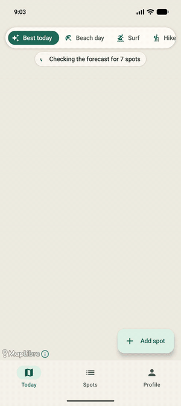
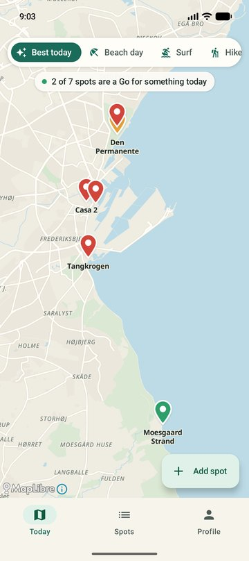
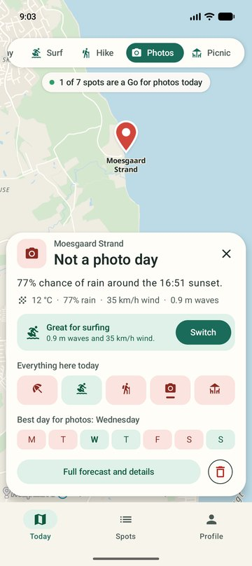
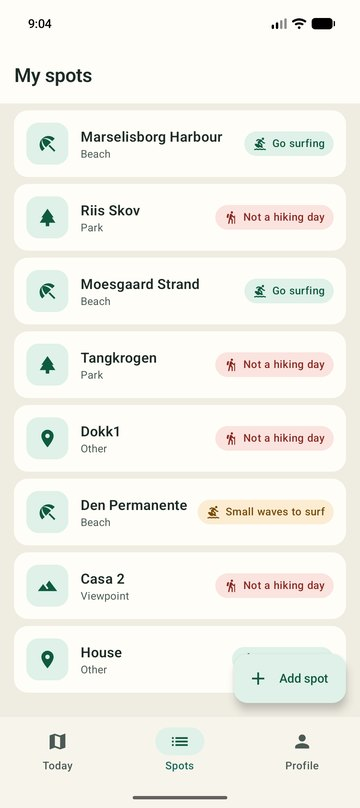
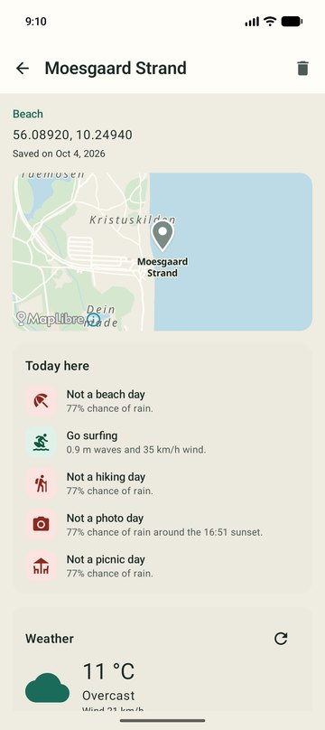
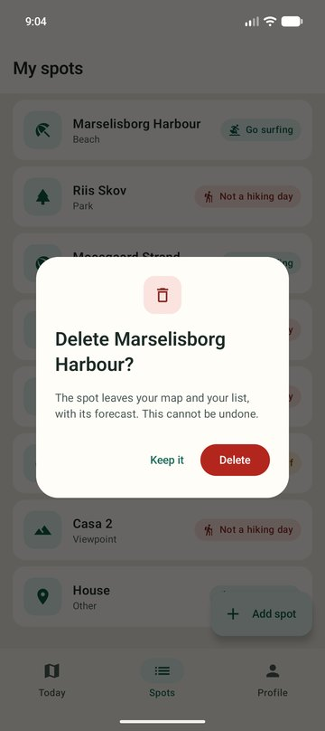
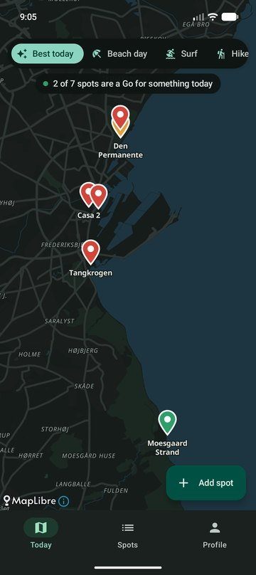
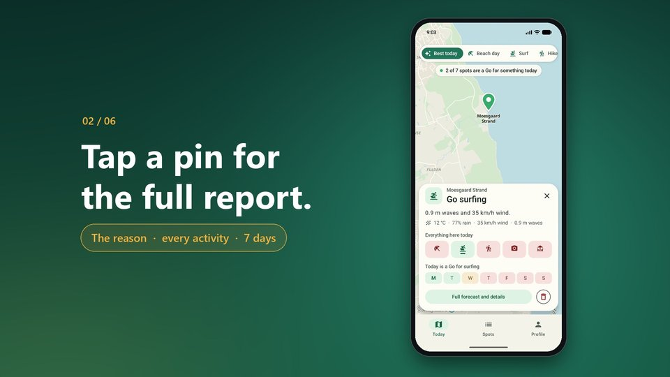

# SpotCast

Android app for the SWMAD-01 group project. SpotCast tells you where to go today: every
spot you save gets a **Go**, **Maybe** or **Skip** for a beach day, surfing, hiking, photos
and a picnic, worked out from its own forecast. The app opens on a map where each pin has
the colour of today's answer; tap a pin for the reason, a better activity for that spot, and
the best day of the week.

Package name: `com.swmad.spotcast`

<p align="center">
  
</p>

## Preview

| Today | Report card | Spots |
|:---:|:---:|:---:|
|  |  |  |
| **Spot details** | **Delete, with confirmation** | **Dark theme** |
|  |  |  |

### Demo video

[](docs/SpotCast_demo.mp4)

Click the image to open the video (41 seconds, recorded on the Pixel 10a emulator).

## Demo, report and synopsis

- [Demo video](docs/SpotCast_demo.mp4) (41 seconds, recorded on the Pixel 10a emulator)
- [Project report](docs/Report.pdf)
- [Synopsis](docs/Synopsis.pdf)

## What is in the project

| Requirement | Where |
|---|---|
| Kotlin, coroutines | all of `app/src/main/java/com/swmad/spotcast` |
| Jetpack Compose | `ui/` |
| Compose Navigation | `ui/navigation/Navigation.kt` |
| Firebase Authentication | `integration/auth/AuthFireBaseService.kt` |
| Firestore | `integration/firestore/FireStoreSpotService.kt` |
| HTTP API with Ktor (Open-Meteo forecast and marine) | `integration/weather/KtorWeatherService.kt` |
| HTTP API with Ktor (Nominatim address search) | `integration/geocoding/KtorGeocodingService.kt` |
| GPS | `integration/location/LocationService.kt`, `ui/spots/AddSpotScreen.kt` |
| Save a place you are not at | `ui/spots/AddSpotScreen.kt` ("Another place": address or coordinates, confirmed on a map) |
| Go / Maybe / Skip rules per activity | `domain/Activity.kt`, tested in `app/src/test/.../ActivityRulesTest.kt` |
| Map-first home with activity bar and report card | `ui/map/MapScreen.kt` |
| Map (MapLibre with OpenFreeMap tiles, recoloured) | `ui/components/SpotMap.kt`, used in `ui/map/MapScreen.kt`, `ui/details/DetailsScreen.kt` and `ui/spots/AddSpotScreen.kt` |
| Delete a spot with confirmation | `ui/components/DeleteSpotDialog.kt`: hold a spot in the list or its pin, or the delete button on the card or in the details |
| Light, dark or system theme | `ui/theme/ThemeViewModel.kt`, chosen in `ui/profile/ProfileScreen.kt`, applied in `MainActivity.kt` |
| Firestore real-time updates | `FireStoreSpotService.observeSpots`, collected in `ui/spots/SpotsViewModel.kt` |

The map is drawn by MapLibre with the free OpenFreeMap vector tiles (OpenStreetMap data). It
needs no API key, no Google Cloud project and no billing account. The weather APIs need no
key either. The only account the app depends on
is the Firebase project.

## Setup

### 1. Firebase

1. Create a project at https://console.firebase.google.com (analytics can stay off).
2. Add an Android app with the package name `com.swmad.spotcast`.
3. Download `google-services.json` and put it in `app/`. This file is not in the
   repository (it is listed in `.gitignore`), so the project does not build until it is
   there.
4. Authentication: enable the provider "Email/Password".
5. Firestore Database: create the database, then paste the content of `firestore.rules`
   into the Rules tab and publish.
6. Create the test user for the report under Authentication > Users, or sign up in the app.

### 2. Run

Open the `SpotCast` folder in Android Studio and run the `app` configuration, or:

```
gradlew :app:assembleDebug
```

In the emulator the GPS position is set under Extended controls > Location.

## Hand-in

- Clean zip: run `gradlew clean`, then zip the folder without `.gradle`, `.idea`, `.kotlin`,
  `build`, `app/build` and `local.properties`. Keep `app/google-services.json` in the zip,
  otherwise the app cannot sign in on the examiner's machine.
- A signed APK is only asked for when Google Maps is used, which this app does not.

## Data

Firestore: `users/{uid}/spots/{spotId}` with the fields `name`, `category`, `note`,
`location` (geopoint) and `createdAt` (server timestamp).

Weather: `GET https://api.open-meteo.com/v1/forecast` with `latitude`, `longitude`,
`current`, `daily` (weather code, temperature, rain chance, wind, cloud cover, sunset),
`timezone` and `forecast_days`. For beach spots also
`GET https://marine-api.open-meteo.com/v1/marine` with `daily=wave_height_max`. No key is needed.

Address search: `GET https://nominatim.openstreetmap.org/search` with `q`, `format=jsonv2`
and `limit=1`. No key is needed; the service asks for a User-Agent and at most one request
per second.

Map style and tiles: `https://tiles.openfreemap.org/styles/positron`, (c) OpenMapTiles,
data (c) OpenStreetMap contributors.

## Tests

```
gradlew :app:testDebugUnitTest
```
